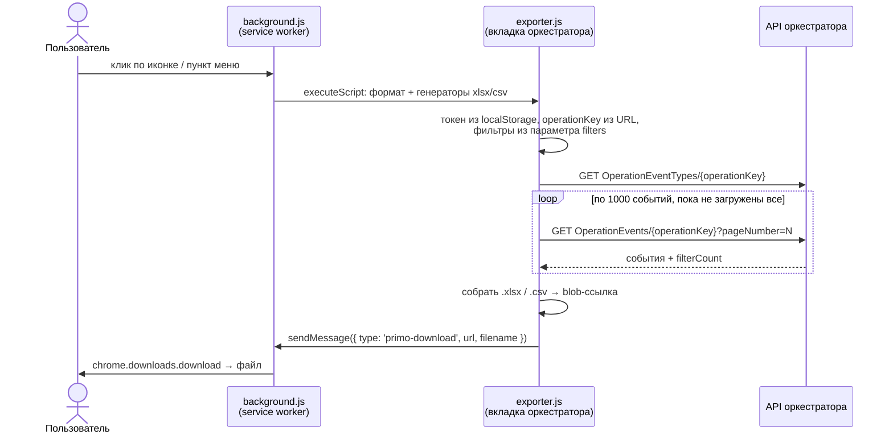

<div align="center">


# Primo Logs → Excel

**Расширение Chrome, которое выгружает все события операции робота из Primo Orchestrator в Excel или CSV
одним кликом, с учётом фильтров на странице.**

[](https://github.com/gas3v/primo-logs-export/actions/workflows/ci.yml)
[](https://github.com/gas3v/primo-logs-export/releases/latest)


[Установка](#установка) · [Использование](#использование) · [Что в файле](#что-в-файле) ·
[Диагностика](#диагностика) · [Как устроено](docs/architecture.md) · [Changelog](CHANGELOG.md)

</div>

---

Таблица событий в Primo Orchestrator показывает события постранично, и выгрузки в ней нет. Расширение
загружает через API оркестратора **все** события операции с теми же фильтрами, что выставлены на странице,
и сохраняет их в `.xlsx` или `.csv`.

## Возможности

- **Все события, а не одна страница таблицы.** Постраничная загрузка по 1000 событий с прогрессом
  и оценкой оставшегося времени.
- **Фильтры страницы учитываются:** период, EntityId, ElementName / ElementId / ElementClass, сообщение,
  «со снимком экрана».
- **Excel:** закреплённая строка заголовков, автофильтр, настоящие даты Excel с миллисекундами.
- **CSV для русского Excel:** разделитель `;`, UTF-8 с BOM, файл открывается двойным щелчком.
- **Понятные названия событий** из справочника оркестратора, например «ProjectCompleted, Success».
- **Ничего не уходит наружу.** Запросы идут только к открытому во вкладке оркестратору, файл
  формируется локально в браузере. Без сторонних библиотек и удалённого кода.
- **Минимальные права.** Доступ к вкладке появляется только по клику на иконку (`activeTab`).

Поддерживаемые страницы (события операции робота):

```
/administration/robots/<robotId>/operation/<operationKey>/<robotName>/...
/journal/orchestrator-robots/<operationKey>/operation/<robotName>?...
```

Проверено на Primo Orchestrator UI 4.26.7.x / WebApi 1.26.7.x и Google Chrome.

## Установка

1. Скачайте `primo-logs-export-<версия>-install.zip` со страницы
   [Releases](https://github.com/gas3v/primo-logs-export/releases/latest) и распакуйте в постоянную папку,
   например `C:\Tools\primo-logs-export`. Chrome загружает расширение из этой папки, поэтому не удаляйте её.
2. Откройте `chrome://extensions` и включите **Режим разработчика** (переключатель справа вверху).
3. Нажмите **Загрузить распакованное расширение** и выберите папку с `manifest.json`.
4. Закрепите иконку на панели: значок пазла → булавка.

> [!NOTE]
> Если переключателя «Режим разработчика» нет или он неактивен, установку запрещает политика компании.
> Обратитесь к администратору.

**Обновление:** замените файлы в той же папке, нажмите круглую стрелку на карточке расширения
в `chrome://extensions` и обновите страницу оркестратора (F5).

## Использование

1. Войдите в оркестратор и откройте события операции: **Роботы → робот → операция → события**.
2. При необходимости выставьте фильтры.
3. Выгрузите файл:

   | Действие | Результат |
   |---|---|
   | Клик по иконке | Excel (`.xlsx`) |
   | Правый клик по иконке → «Выгрузить в CSV» | CSV (`.csv`) |
   | Правый клик по иконке → «Выгрузить в Excel (.xlsx)» | Excel (`.xlsx`) |

4. Справа внизу страницы появится плашка с прогрессом («Загружено событий: N из M…» и примерное
   оставшееся время), затем сохранится файл:

   ```
   logs_<робот>_<проект>_<операция>_<ГГГГММДД_ччммсс>.xlsx
   ```

   Если в Chrome включено «Всегда указывать место для скачивания», появится диалог сохранения.
   На плашке есть кнопка «Скачать ещё раз».

Сервер отдаёт около 1000 событий за 2–5 секунд, поэтому операция на 10–15 тысяч событий выгружается
примерно за минуту. Повторные клики, пока идёт выгрузка, игнорируются.

## Что в файле

Колонки в Excel и CSV одинаковые:

| Колонка | Поле API |
|---|---|
| Дата события | `eventDate` |
| Источник | `source`: 0 → «Робот», 1 → «Оркестратор» |
| Событие | название из справочника типов событий, например «ProjectCompleted, Success» |
| ElementName | `parsedElementName` |
| Сообщение | `parsedMessage`, если пусто — `text` |
| ElementId, ElementClass | `parsedElementId`, `parsedElementClass` |
| Полный текст | `text`, исходная строка лога робота |
| Проект, Робот, Агент, Пользователь | `projectName`, `robotName`, `workerName`, `userName` |
| EntityId, Код события | `entityId`, `event` |
| Время в оркестраторе | `orchTimestampUtc` |
| Снимок экрана | `screenFilePath` |
| Подпись корректна | `correctSignature`: «Да» / «Нет» |
| Id | `id` события |

<details>
<summary><b>Подробнее о форматах</b></summary>

**Excel** — один лист «Логи»: строка заголовков закреплена, включён автофильтр. Даты хранятся как настоящие
даты Excel в формате `дд.мм.гггг чч:мм:сс.000`, поэтому сортировка и фильтрация работают. Ячейки длиннее
32 767 символов (лимит Excel) обрезаются.

**CSV** рассчитан на Excel с русской локалью: разделитель `;`, кодировка UTF-8 с BOM, строки через CRLF,
поля с `;`, кавычками и переводами строк — в кавычках. Даты записываются текстом `дд.мм.гггг чч:мм:сс.000`.
Текст не обрезается. Значения не изменяются: если сообщение робота начинается с `=`, `+`, `-` или `@`,
Excel при открытии CSV может принять его за формулу.

В обоих форматах даты записываются как есть, без пересчёта часового пояса. Из текстовых полей удаляются
невидимые символы нулевой ширины (U+200B и подобные), которые добавляет робот.

</details>

## Ограничения

- Фильтры **по источнику, типу события и тексту** в API не передаются (UI 4.26.7.x не отправляет их в запрос),
  поэтому в выгрузку могут попасть лишние строки. Отфильтруйте их в Excel.
- Нужна действующая сессия в оркестраторе. Если она истекла, расширение предложит перезайти.
- Все события и итоговый файл держатся в памяти вкладки. Операции на сотни тысяч событий выгружаются
  много минут и могут упереться в память браузера.
- Начатую выгрузку можно остановить только перезагрузкой страницы.

## Диагностика

| Симптом | Причина | Что делать |
|---|---|---|
| Красный значок `ERR` на иконке | Chrome не дал внедрить скрипт в страницу | Наведите курсор на иконку: в подсказке будет текст ошибки. Его же показывает кнопка «Ошибки» на карточке в `chrome://extensions` |
| Плашка «Это не страница событий операции робота» | Открыта другая страница оркестратора | Перейдите к событиям операции |
| Плашка «Сессия истекла (401)» | Токен устарел | Перезайдите в оркестратор |
| Плашка «Не найден токен авторизации» | Вы не вошли или открыт не оркестратор | Войдите в оркестратор |
| Оранжевая плашка «…автоматически не сохранён» | `chrome.downloads` не сохранил файл (причина на плашке) | Нажмите на плашке «Скачать файл» |
| В меню иконки нет «Выгрузить в CSV» | Расширение обновили, но не перезагрузили | Нажмите круглую стрелку на карточке в `chrome://extensions` |
| CSV открылся в одну колонку или с «кракозябрами» | Файл открыт не в Excel с русской локалью или импортирован с другими настройками | Откройте двойным щелчком или при импорте укажите UTF-8 и разделитель `;` |
| `Could not load file '…'. It isn't UTF-8 encoded.` | В JS-файле есть недопустимые символы, например U+FFFE/U+FFFF | Запустите `scripts/pack.ps1`: он находит такие символы |

## Как это работает



Файл сохраняет service worker через `chrome.downloads`: Chrome блокирует повторные автоматические
скачивания со страницы до её перезагрузки, а на `chrome.downloads` это ограничение не действует.
Подробности, формат API и фильтров — в [docs/architecture.md](docs/architecture.md).

## Структура проекта

```
manifest.json         манифест MV3: activeTab, scripting, downloads, contextMenus
background.js         service worker: клик и меню иконки, внедрение скриптов, сохранение через chrome.downloads
exporter.js           выгрузка: токен, фильтры, постраничная загрузка, строки таблицы, передача файла
xlsx-writer.js        генератор .xlsx без зависимостей (ZIP без сжатия + SpreadsheetML)
csv-writer.js         генератор .csv для Excel с русской локалью (; + UTF-8 BOM)
icons/                иконки 16/32/48/128
test/                 тесты генераторов (node --test)
scripts/pack.ps1      проверка кодировок и сборка ZIP: для Chrome Web Store и для установки вручную
УСТАНОВКА.txt         короткая инструкция, кладётся в install-архив
docs/                 устройство и API (architecture.md), публикация в магазине (publishing.md)
.github/workflows/    CI: проверки, тесты, сборка; релиз по тегу v*
```

## Разработка

Нужны Node.js 22+ (для проверок и тестов) и Windows PowerShell 5.1 (для сборки).

```powershell
npm run check     # синтаксис всех JS-файлов
npm test          # тесты генераторов xlsx и csv
powershell -ExecutionPolicy Bypass -File scripts\pack.ps1   # проверка кодировок и сборка dist/*.zip
```

После изменений перезагрузите расширение в `chrome://extensions` и проверьте выгрузку в оба формата
на стенде. Порядок ручной проверки — в [docs/architecture.md](docs/architecture.md#проверка).

> [!IMPORTANT]
> Невидимые и «особые» символы (U+200B…U+200D, U+FEFF, U+FFFE, U+FFFF) в JS пишите только
> escape-последовательностями. Редакторы легко превращают их в сами символы, а `pack.ps1` такую сборку
> не пропустит.

### Выпуск версии

1. Поднимите `version` в `manifest.json` и `package.json`, добавьте запись в [CHANGELOG.md](CHANGELOG.md).
2. Закоммитьте и поставьте тег: `git tag v1.2.0 && git push --follow-tags`.
3. CI проверит, что тег совпадает с версией в манифесте, соберёт архивы и опубликует релиз
   с заметками из CHANGELOG.

Публикация в Chrome Web Store описана в [docs/publishing.md](docs/publishing.md).
